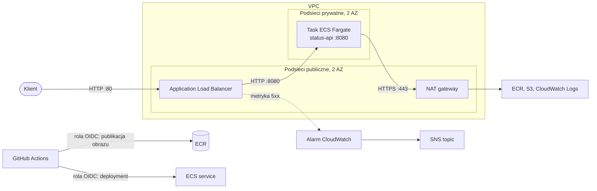

# status-api w AWS

Prosty serwis HTTP uruchomiony na Amazon ECS Fargate. Infrastruktura jest zdefiniowana w Terraformie i Terragruncie, a pipeline GitHub Actions testuje, buduje i deployuje aplikację na środowisko dev.

**Status:** dev jest deployowany przez pipeline. Prod jest zdefiniowany jako konfiguracja w `infra/live/prod`, ale nie został zdeployowany.

## Gdzie co znaleźć

| Temat | Miejsce |
| --- | --- |
| Uruchomienie aplikacji lokalnie | [`app/README.md`](app/README.md#uruchomienie-lokalnie) |
| Użycie i weryfikacja kodu Terraform | [`infra/README.md`](infra/README.md#weryfikacja-bez-konta-aws) |
| Architektura | [Architektura](#architektura) |
| Pipeline CI/CD | [CI/CD](#cicd) |
| Kluczowe decyzje i kompromisy | [Kluczowe decyzje](#kluczowe-decyzje-i-kompromisy) |
| Wybór ECS zamiast EC2 | [Dlaczego ECS zamiast EC2](#dlaczego-ecs-zamiast-ec2) |
| Konfiguracja dev i prod | [Konfiguracja dev i prod](#konfiguracja-dev-i-prod) |
| Izolacja stanu Terraform | [Izolacja stanu](#izolacja-stanu-terraform) |
| Zatwierdzanie zmian i rollback | [Promocja na prod](#promocja-na-prod) |
| Monitoring i alarmy na prod | [Monitoring](#monitoring) |
| Pominięte elementy i następne kroki | [Co pominąłem](#co-pominąłem-lub-uprościłem) |
| Założenia | [Założenia](#założenia) |
| Poświęcony czas | [Poświęcony czas](#poświęcony-czas) |

## Architektura



- Taski działają w podsieciach prywatnych, bez publicznego adresu IP, i ruch do nich może kierować wyłącznie load balancer.
- Logi aplikacji trafiają do grupy CloudWatch Logs `/ecs/status-api`.
- Pipeline używa OIDC do `assumeRole`, dzięki czemu żadne sekrety AWS nie muszą być przechowywane.

```text
app/                    Aplikacja w Go, Dockerfile i dokumentacja aplikacji
infra/                  Dokumentacja infrastruktury
infra/modules/          Moduły Terraform
infra/live/dev/         Konfiguracja środowiska dev
infra/live/prod/        Konfiguracja środowiska prod (bez deploymentu)
.github/workflows/      Pipeline'y aplikacji, infrastruktury i skanowania sekretów
```

## CI/CD

| Trigger | Co jest uruchamiane |
| --- | --- |
| **Pull request** | `go vet`, `go test`, budowanie obrazu, walidacja Terraform i Terragrunt, TFLint, Checkov, Gitleaks |
| **Merge do `main`** | Te same checki, a następnie publikacja obrazu w ECR i deployment na dev |
| **Uruchomienie ręczne** | Ponowne zbudowanie i deployment albo deployment istniejącego obrazu przez parametr `image_tag` |

Job `deploy-dev` pobiera najnowszą task definition, zmienia w niej wyłącznie obraz, rejestruje nową revision, aktualizuje ECS service i czeka, aż będzie stabilny.

Dwie osobne role IAM ograniczają zakres uprawnień:

| Rola | Kto może zrobić `assumeRole` | Co może zrobić |
| --- | --- | --- |
| `status-api-ecr-push` | Branch `main` tego repozytorium | Publikować obrazy w tym repozytorium ECR |
| `status-api-deploy` | Środowisko GitHub `dev` tego repozytorium | Rejestrować task definitions, aktualizować ten ECS service i przekazywać jego execution role |

Trust policies używają formatu immutable subject z GitHuba, który zawiera identyfikatory właściciela i repozytorium. Dzięki temu repozytorium utworzone ponownie pod tą samą nazwą nie może zrobić `assumeRole` na tych rolach.

## Kluczowe decyzje i kompromisy

| Decyzja | Uzasadnienie | Kompromis |
| --- | --- | --- |
| **ECS Fargate zamiast EC2** | Brak serwerów do aktualizowania i skalowania przy jednym małym, bezstanowym serwisie | Wyższy koszt jednostkowy i mniejsza kontrola nad hostem |
| **Terragrunt ze zwykłymi modułami Terraform** | Środowiska różnią się tylko wartościami, każdy unit ma własny stan, a konfiguracja backendu i providera jest generowana w jednym miejscu | Dodatkowe narzędzie, a `terraform validate` działa tylko na poziomie modułów. Workspaces lub pliki tfvars byłyby prostsze, ale dają słabszą izolację |
| **Współdzielony ALB i klaster ECS w każdym środowisku** | Niższy koszt, a nowe serwisy dodają tylko routing | Błędna zmiana w ALB może wpłynąć na wszystkie serwisy |
| **Routing po nazwie hosta** | Reguły się nie nakładają, więc zespoły nie muszą uzgadniać priorytetów listenera | Kolejne serwisy wymagają prawdziwej domeny. `status-api` używa na razie nazwy DNS load balancera |
| **Jeden NAT gateway na dev, po jednym na AZ na prod** | Niższy koszt środowiska dev | Awaria tej strefy AZ odcina na dev dostęp wychodzący |
| **CI aktualizuje ECS bezpośrednio zamiast uruchamiać `terragrunt apply`** | CI nie potrzebuje dostępu do stanu Terraform i ma znacznie mniej uprawnień | Git nie pokazuje działającego obrazu, a Terraform po utworzeniu ECS service ignoruje jego `task_definition` |
| **Immutable tagi obrazów oparte na SHA commita** | Każdy deployment można odtworzyć, a rollback jest niezawodny | Każde budowanie wymaga nowego tagu |
| **Współdzielone repozytorium ECR** | Prod uruchamia dokładnie ten obraz, który przetestowano na dev, bez kopiowania | Prod zależy od konta, na którym znajduje się repozytorium |

### Dlaczego ECS zamiast EC2

Wybrałem ECS Fargate, ponieważ wiele elementów, które na EC2 musiałbym zbudować i utrzymywać samodzielnie, jest tu dostępnych od razu:

| Obszar | ECS Fargate | EC2 |
| --- | --- | --- |
| **Deployment aplikacji** | Nowa wersja to nowy obraz i nowa revision task definition, a ECS sam wymienia taski | Trzeba przygotować AMI lub skrypty startowe oraz sposób wymiany wersji na instancjach |
| **Nowe serwisy** | Każdy serwis ma własny kontener z zależnościami, zasobami CPU i pamięci oraz rolą IAM | Serwisy o różnych wymaganiach trzeba rozdzielać na instancjach i pilnować konfliktów zależności |
| **Rollback** | Circuit breaker wykrywa nieudany deployment i automatycznie wraca do ostatniej działającej wersji | Mechanizm wykrywania awarii i powrotu do poprzedniej wersji trzeba zbudować samodzielnie |
| **Logi** | Log driver `awslogs` wysyła logi kontenera do CloudWatch Logs po dodaniu kilku linii konfiguracji | Trzeba zainstalować i skonfigurować agenta CloudWatch |
| **Integracje** | ECS sam rejestruje taski w target group ALB i zastępuje taski, które nie przechodzą health checka | Wymaga konfiguracji Auto Scaling Group i jej integracji z ALB |
| **Utrzymanie** | AWS zarządza hostami | Aktualizacje systemu, skalowanie i capacity instancji są po mojej stronie |

Kompromisem jest wyższy koszt jednostkowy i mniejsza kontrola nad hostem.

### Konfiguracja dev i prod

Oba środowiska korzystają z tych samych modułów. Różnią się wyłącznie wartości w `infra/live/<env>`:

| Ustawienie | Dev | Prod |
| --- | --- | --- |
| CIDR VPC | `10.10.0.0/16` | `10.20.0.0/16` |
| Podsieci prywatne | `/24` | `/20` |
| NAT | `single` | `per_az` |
| Deletion protection ALB | Wyłączona | Włączona |
| Container Insights | `disabled` | `enhanced` |
| Liczba tasków | 1 | 2 |
| `GREETING` | `Hello from dev` | `Hello from prod` |
| Zachowanie logów po usunięciu ECS service | Nie | Tak |
| Środowisko GitHub | `dev` | `prod` |

### Izolacja stanu Terraform

- Każde konto AWS ma własny bucket S3 na stan, więc stany dev i prod są całkowicie rozdzielone.
- Każdy unit ma osobny plik stanu z kluczem opartym na ścieżce, np. `dev/eu-north-1/vpc/terraform.tfstate`. Błąd w jednym unicie nie zmieni stanu innego.
- Stan jest szyfrowany, wersjonowany i blokowany za pomocą locków w S3.
- Bucket blokuje dostęp publiczny, wymaga TLS i zabrania usuwania plików `*.tfstate`.
- `allowed_account_ids` zapobiega zastosowaniu unitu na niewłaściwym koncie AWS.

### Bezpieczeństwo

- **IAM:** każda rola jest ograniczona do własnego repozytorium, serwisu i grupy logów. Aplikacja nie ma task role, ponieważ nie wywołuje API AWS.
- **Sieć:** taski przyjmują ruch tylko z ALB na porcie aplikacji i mogą nawiązywać wyłącznie wychodzące połączenia HTTPS.
- **Kontener:** obraz distroless działa jako użytkownik non-root i korzysta z read-only root filesystem.
- **Sekrety:** repozytorium nie zawiera danych uwierzytelniających, a Gitleaks skanuje całą historię Gita. Aplikacja nie ma obecnie sekretów. Prawdziwy sekret byłby pobierany z Secrets Manager lub SSM przez ustawienie `secrets` w task definition.

Checkov pomija 16 checków, a każde pominięcie ma uzasadnienie w kodzie. Pełna lista znajduje się w [`infra/README.md`](infra/README.md#pominięte-checki-checkova).

## Promocja na prod

Job deploymentu na prod nie został zbudowany. Działałby w następujący sposób:

1. Merge do `main` deployuje aplikację na dev.
2. Job `deploy-prod` uruchamia się po `deploy-dev` w środowisku GitHub `prod`, które wymaga zatwierdzenia przez reviewera i dopuszcza tylko protected branches.
3. Po zatwierdzeniu deployuje **ten sam obraz (SHA)**, który działał na dev, bez ponownego budowania.

### Skąd prod pobiera obraz

| | Współdzielony ECR (skonfigurowany) | ECR na każdym koncie |
| --- | --- | --- |
| **Jak to działa** | Prod pobiera obraz bezpośrednio ze współdzielonego repozytorium | Pipeline kopiuje przetestowany obraz do repozytorium prod |
| **Wymagane zmiany** | Dodanie repository policy pozwalającej kontu prod pobierać obrazy. Docelowo przeniesienie repozytorium na tooling account | Dodanie unitu `ecr` do prod i kroku kopiowania, np. `crane copy`, przed deploymentem |
| **Kompromis** | Prostsze, ale prod zależy od współdzielonego konta | Pełna izolacja, ale dodatkowy krok w release |

### Rollback i sytuacja, gdy `/health` przestaje odpowiadać

**W trakcie deploymentu** poprzednia wersja nadal obsługuje ruch, a nowe taski dopiero startują:

1. Nowe taski nie przechodzą health checka ALB, więc nie dostają ruchu, a ECS je zastępuje.
2. Circuit breaker oznacza deployment jako nieudany po 3 nieudanych taskach przy tej skali serwisu.
3. ECS automatycznie wraca do ostatniego udanego deploymentu.
4. Job w pipeline kończy się błędem, więc zespół widzi, że release się nie powiódł.

**Po zakończeniu deploymentu** circuit breaker już nie działa:

1. ALB oznacza task jako unhealthy po 3 nieudanych health checkach, czyli po około 90 sekundach.
2. ECS zastępuje task, ale tą samą wersją, więc problem się utrzymuje.
3. Alarm CloudWatch powiadamia zespół.
4. Jeśli przyczyną jest release, należy zdeployować poprzedni obraz. Zajmuje to kilka minut, ponieważ nic nie jest budowane od nowa:

   ```sh
   gh workflow run app.yml --ref main -f image_tag=<sha-poprzedniego-commita>
   ```

Jeśli przyczyną jest zależność, a nie release, rollback nie pomoże. Dlatego `/health` sprawdza wyłącznie sam serwis, aby awaria zależności nie powodowała zastępowania healthy tasków przez ECS. ECR przechowuje 20 ostatnich obrazów, co określa, jak daleko można się cofnąć.

## Monitoring

Na dev działa jeden alarm CloudWatch, czyli wybrane przeze mnie zadanie dodatkowe. Uruchamia się, gdy ALB zwraca co najmniej 5 własnych błędów 5xx na minutę przez 3 minuty, i wysyła powiadomienie do SNS topic. Subskrypcje e-mail są dodawane poza kodem, aby adresy nie trafiły do tego publicznego repozytorium.

Planowane alarmy dla prod:

| Sygnał | Metryka | Alert, gdy | Priorytet |
| --- | --- | --- | --- |
| **Niedostępność serwisu** | ALB `HealthyHostCount` | Poniżej 1 przez 1 minutę | Pilny |
| **Unhealthy taski** | ALB `UnHealthyHostCount` | Powyżej 0 przez 5 minut | Zgłoszenie |
| **Błędy ALB** | `HTTPCode_ELB_5XX_Count` | Co najmniej 5 na minutę przez 3 minuty | Pilny |
| **Błędy aplikacji** | `HTTPCode_Target_5XX_Count` jako udział w requestach | Powyżej 1% przez 5 minut | Pilny |
| **Latency** | `TargetResponseTime` p95 | Powyżej 500 ms przez 10 minut | Zgłoszenie |
| **Capacity** | ECS `RunningTaskCount` | Poniżej oczekiwanej liczby przez 5 minut | Pilny |
| **Saturation** | Wykorzystanie CPU i pamięci w ECS | Powyżej 80% przez 10 minut | Zgłoszenie |
| **Nieudany release** | Zdarzenie niepowodzenia deploymentu ECS w EventBridge | Każde niepowodzenie | Pilny |
| **Błędy w logach aplikacji** | Metric filter CloudWatch Logs | Nagły wzrost | Zgłoszenie |

Progi są punktem wyjścia i należy je dostroić na podstawie rzeczywistego ruchu. Pilne alerty trafiałyby przez SNS na kanał on-call, a prod korzystałby z Container Insights z enhanced observability do budowy dashboardów.

## Co pominąłem lub uprościłem

| Element | Stan obecny | Następny krok |
| --- | --- | --- |
| **HTTPS** | ALB ma tylko listener HTTP | Dodanie domeny, certyfikatu ACM i listenera HTTPS |
| **Deployment prod** | Tylko konfiguracja | Dodanie joba `deploy-prod` i opisanego wyżej dostępu do ECR |
| **Autoscaling** | Stała liczba tasków | Dodanie target tracking według CPU lub liczby requestów |
| **Hardening sieci** | Taski mogą łączyć się przez NAT z dowolnym hostem HTTPS | Dodanie VPC endpoints i usunięcie ogólnego dostępu do internetu |
| **Audyt i logowanie** | Brak access logów ALB, flow logów VPC i access logów stanu | Włączenie ich na prod |
| **Klucze szyfrujące** | Domyślne szyfrowanie AWS | Customer-managed KMS keys tam, gdzie wymaga tego zgodność z przepisami |
| **WAF** | Nieskonfigurowany | Dodanie AWS WAF do publicznego ALB na prod |
| **Opcje serwisów** | Jeden kontener i tylko wychodzący HTTPS | Dodanie parametrów dla sidecarów, sekretów i dodatkowych reguł wychodzących, gdy serwis będzie ich potrzebować |

**Znane ograniczenie:** pipeline buduje każdy release na podstawie najnowszej task definition, więc ręczna zmiana w konsoli AWS przeszłaby do kolejnych deploymentów, a Terraform by jej nie wykrył. Na prod ograniczyłbym przez IAM możliwość rejestrowania task definitions i aktualizowania ECS services. Dla silniejszej ochrony Terraform mógłby publikować ARN swojej revision w parametrze SSM, a pipeline zawsze zaczynałby od tej revision.

## Założenia

- Na potrzeby zadania używane jest jedno konto AWS. Docelowo każde środowisko ma własne konto, a obrazy znajdują się na koncie współdzielonym.
- Prod używa zastępczego identyfikatora konta `000000000000`.
- `GREETING` nie jest wartością wrażliwą, dlatego jest zwykłą zmienną środowiskową ustawianą dla każdego środowiska.
- `/health` zwraca `503`, gdy brakuje `GREETING`, co celowo zapobiega kierowaniu ruchu do błędnie skonfigurowanego taska.
- HTTP jest akceptowalny na dev, ponieważ domena nie jest jeszcze dostępna.

## Poświęcony czas

Około 4 godzin, ale tylko dzięki temu że miałem już niektóre moduły (vpc/alb/tfstate-bucket/ecr) w innym swoim projekcie, więc mogłe je skopiować i minimalnie poprawić pod to zadanie.
Bez tego (i AI) musiałbym uciąć część "wspólną" infrastruktury i w założeniach przyjąć że jest ona już stworzona.
Wtedy główna część która by została to:
- ecs-cluster
- ecs-alb-service
- ecr
- github-oidc
- aplikacja
- dokumentacja
- testowanie

Do zrobienia ale zdecydowanie bez części sieciowej. Jako że część sieciową już miałem - postanowiłem ją dołączyć żeby mieć pełniejszy projekt :)

Rozbijając czasowo to mniej więcej:
- 15 minut aplikacja (kod 100% AI - mój review + polecenia + sprawdzanie)
- terraform + terragrunt setup + wstępne CI + tf state bucket - 30 minut
- ~1,5h na pozostałe moduły (zmiany moich gotowych + napisanie nowych)
- Ok. godziny-1,5 na poprawianie CI (automatyczny deploy, environments, etc.) i testowanie wszystkiego
- Reszta na generowanie dokumentacji AI + review + moje ręczne poprawki tego co mi nie podpasowało i opisanie poświęconego czasu

